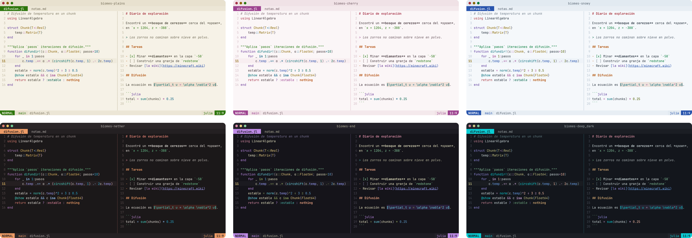
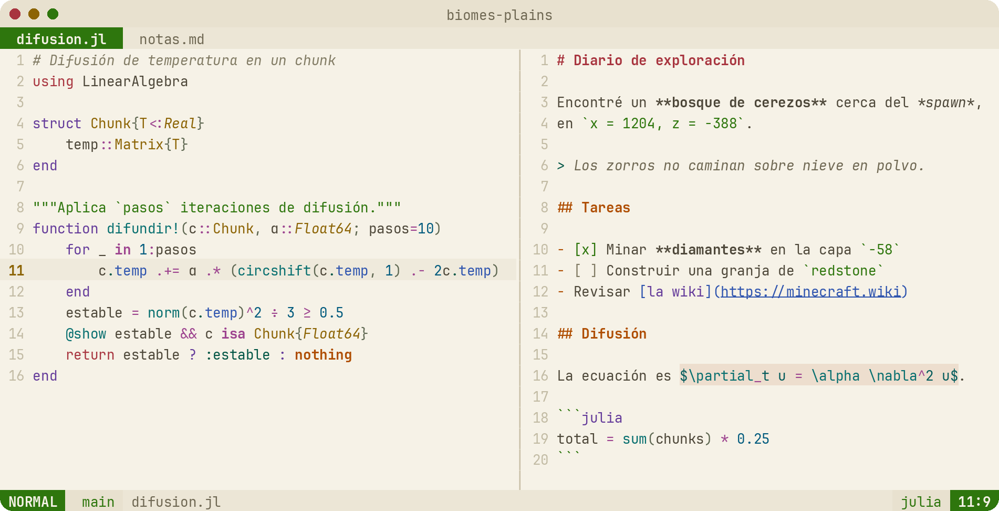
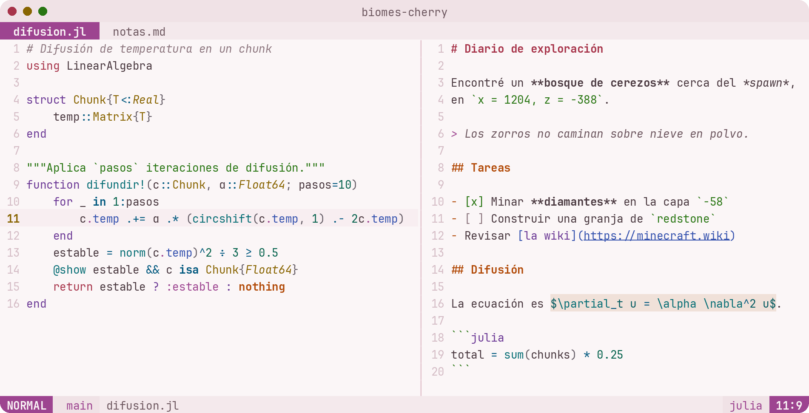
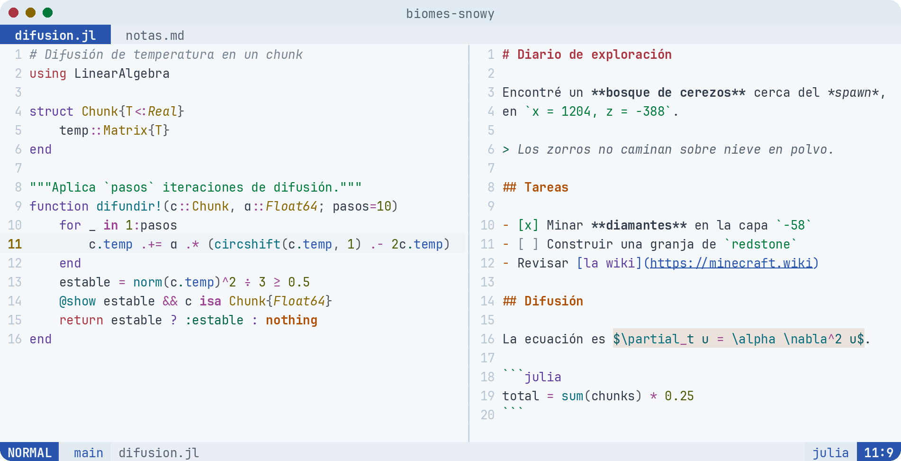
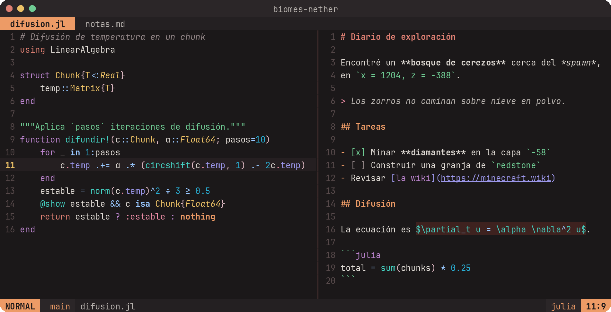
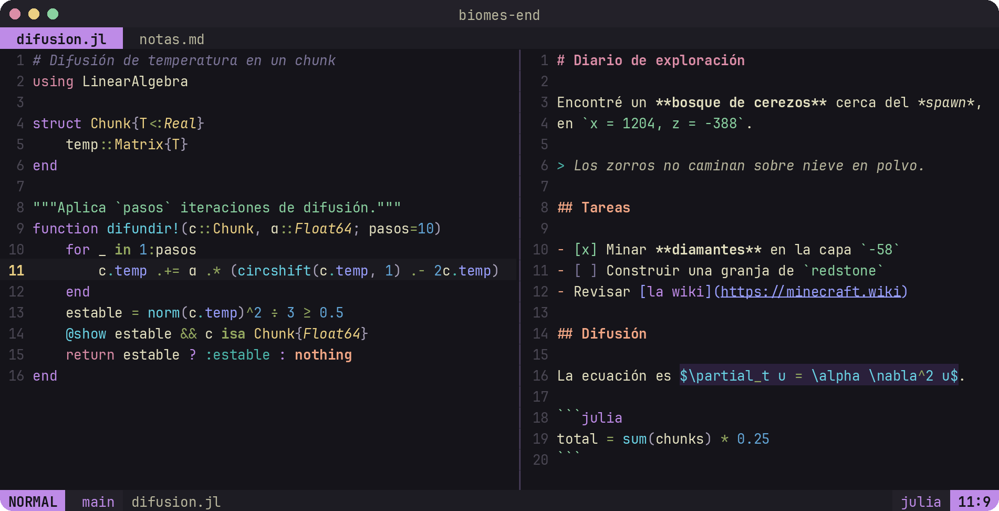
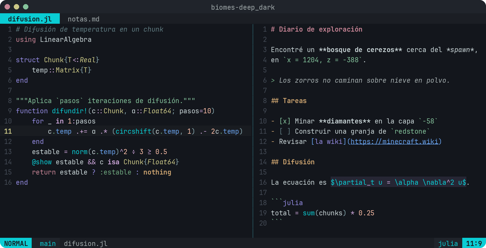

# ⛏️ biomes.nvim

A soft pastel Neovim colorscheme inspired by Minecraft: three light Overworld
biomes and three dark places.

> [!NOTE]
> Not an official Minecraft product. Not approved by or associated with Mojang or Microsoft.

| Variant | Mode | Inspiration |
|---|---|---|
| 🌾 **Plains** | ☀️ light | birch, grass, flowers, redstone, gold, diamond and lapis |
| 🌸 **Cherry** | ☀️ light | Cherry Grove: petals, cherry wood, grass and lavender |
| ❄️ **Snowy** | ☀️ light | snow, blue ice, spruces, foxes and sweet berries |
| 🔥 **Nether** | 🌙 dark | blackstone, lava, glowstone, quartz, warped & crimson fungi, soul fire |
| 🌌 **End** | 🌙 dark | the void, end stone, purpur, chorus plants and ender pearls |
| 🌑 **Deep Dark** | 🌙 dark | deepslate, glowing sculk and the Ancient City |



<details>
<summary>Each variant in full size</summary>

### 🌾 Plains


### 🌸 Cherry Grove


### ❄️ Snowy


### 🔥 Nether


### 🌌 The End


### 🌑 Deep Dark


</details>

## ✨ Features

- Six variants with matching semantic palettes
- Sets `background` automatically, and `:set background=light/dark` switches between
  your last light and dark variants
- Treesitter, LSP (semantic tokens, inlay hints, diagnostics) and diff support.
  Semantic tokens link to the Treesitter colors, so code looks the same with or
  without a language server, plus extra hints such as standard library functions
  in italics
- [lualine](https://github.com/nvim-lualine/lualine.nvim) theme for each variant, picked up automatically
- `:terminal` colors from the active palette
- Optional transparent background
- Written in Lua, no dependencies

## 🔌 Supported plugins

- [blink.cmp](https://github.com/Saghen/blink.cmp)
- [bufferline.nvim](https://github.com/akinsho/bufferline.nvim)
- [flash.nvim](https://github.com/folke/flash.nvim)
- [fzf-lua](https://github.com/ibhagwan/fzf-lua)
- [gitsigns.nvim](https://github.com/lewis6991/gitsigns.nvim)
- [indent-blankline.nvim](https://github.com/lukas-reineke/indent-blankline.nvim)
- [lazy.nvim](https://github.com/folke/lazy.nvim)
- [lualine.nvim](https://github.com/nvim-lualine/lualine.nvim)
- [mini.nvim](https://github.com/echasnovski/mini.nvim) (clue, cursorword, diff, files, hipatterns, icons, indentscope, jump, jump2d, notify, pick, starter, statusline, surround, tabline, trailspace)
- [neo-tree.nvim](https://github.com/nvim-neo-tree/neo-tree.nvim)
- [noice.nvim](https://github.com/folke/noice.nvim)
- [nvim-cmp](https://github.com/hrsh7th/nvim-cmp)
- [nvim-dap](https://github.com/mfussenegger/nvim-dap)
- [nvim-navic](https://github.com/SmiteshP/nvim-navic)
- [nvim-notify](https://github.com/rcarriga/nvim-notify)
- [nvim-tree.lua](https://github.com/nvim-tree/nvim-tree.lua)
- [nvim-treesitter-context](https://github.com/nvim-treesitter/nvim-treesitter-context)
- [rainbow-delimiters.nvim](https://github.com/HiPhish/rainbow-delimiters.nvim)
- [render-markdown.nvim](https://github.com/MeanderingProgrammer/render-markdown.nvim)
- [snacks.nvim](https://github.com/folke/snacks.nvim) (dashboard, picker, explorer, indent, notifier)
- [telescope.nvim](https://github.com/nvim-telescope/telescope.nvim)
- [trouble.nvim](https://github.com/folke/trouble.nvim)
- [vim-illuminate](https://github.com/RRethy/vim-illuminate)
- [vimtex](https://github.com/lervag/vimtex)
- [which-key.nvim](https://github.com/folke/which-key.nvim)

Completion menus (blink.cmp, nvim-cmp) and breadcrumbs (navic) share the same
`LspKind*` groups, so a symbol kind has the same color everywhere.

Plugins that reuse Neovim's standard groups (such as todo-comments, grug-far or mason)
pick up the theme colors without extra configuration.

Only the groups of the plugins you have installed are loaded, detected through
lazy.nvim or `vim.pack`. Without either of them, all supported plugins are loaded.
You can override this with the `plugins` option:

```lua
plugins = {
  all = false,       -- load every supported plugin
  auto = true,       -- load only installed plugins
  snacks = false,    -- disable one (module name or "snacks.nvim")
  vimtex = true,     -- force one
}
```

## 📦 Installation

Requires Neovim 0.8+ with `termguicolors`.

### [lazy.nvim](https://github.com/folke/lazy.nvim)

```lua
{
  "ernesxavier/biomes.nvim",
  name = "biomes",
  lazy = false,
  priority = 1000,
  opts = {
    variant = "plains", -- "plains" | "cherry" | "snowy" | "nether" | "end" | "deep_dark"
  },
  config = function(_, opts)
    require("biomes").setup(opts)
    vim.cmd.colorscheme("biomes")
  end,
}
```

### [LazyVim](https://www.lazyvim.org)

```lua
return {
  { "ernesxavier/biomes.nvim", name = "biomes", opts = { variant = "nether" } },
  { "LazyVim/LazyVim", opts = { colorscheme = "biomes" } },
}
```

### `vim.pack` (Neovim 0.12+)

```lua
vim.pack.add({ "https://github.com/ernesxavier/biomes.nvim" })
vim.cmd.colorscheme("biomes-end")
```

## 🚀 Usage

```vim
:colorscheme biomes            " uses the variant from setup()
:colorscheme biomes-plains
:colorscheme biomes-cherry
:colorscheme biomes-snowy
:colorscheme biomes-nether
:colorscheme biomes-end
:colorscheme biomes-deep_dark
```

Full documentation is available inside Neovim with `:help biomes`.

The theme follows `'background'`: `:set background=light` goes back to the last light
variant you used and `:set background=dark` to the last dark one (or `light_variant` /
`dark_variant` the first time).

## ⚙️ Configuration

Default options:

```lua
require("biomes").setup({
  variant = "plains",      -- "plains" | "cherry" | "snowy" | "nether" | "end" | "deep_dark"
  light_variant = "plains", -- first `:set background=light` of the session
  dark_variant = "nether", -- first `:set background=dark` of the session
  transparent = false,     -- don't set a background color (panels and floats included)
  dim_inactive = false,    -- dim the background of unfocused windows
  styles = {
    -- Extra attributes per element; any `:h nvim_set_hl` key works (italic, bold, underline...)
    comments = { italic = true },
    keywords = {},
    functions = {},
    variables = {},
    types = {},
    strings = {},
    operators = {},        -- also `in`, `isa`, `and`... (shown bold)
    -- Panel backgrounds: "shaded" | "normal" | "transparent"
    sidebars = "shaded",   -- neo-tree, nvim-tree, trouble
    floats = "shaded",     -- floating windows, pickers, which-key, completion docs
  },
  -- Change palette colors. Receives a copy, so edit it in place
  on_colors = function(colors, variant) end,
  -- Change highlight groups. Receives a copy, so edit it in place
  on_highlights = function(highlights, colors, variant) end,
})
```

Examples:

```lua
require("biomes").setup({
  styles = { keywords = { italic = true } },
  on_colors = function(colors, variant)
    if variant == "nether" then
      colors.bg = "#120f10" -- darker blackstone
    end
  end,
  on_highlights = function(hl, colors)
    hl.CursorLineNr = { fg = colors.green, bold = true }
    hl.LineNr = { link = "Comment" }
  end,
})
```

The options are annotated for [lua_ls](https://github.com/LuaLS/lua-language-server),
so you get completion inside `setup()`.

The palette of any variant (with `on_colors` applied) is available for your own highlights or statusline:

```lua
local c = require("biomes").palette("nether")
vim.api.nvim_set_hl(0, "MyGroup", { fg = c.orange, bg = c.bg_alt })
```

## 🎨 Palettes

Operators, numbers and punctuation get their own colors, picked to stay apart from
every other color of the variant, so math-heavy code such as Julia reads clearly.
Equations in Markdown and LaTeX (vimtex) sit on a soft band of a block from each
world (raw iron, netherrack, obsidian, deepslate) whose hue is far from the cyan text.

Each variant has an identity color (`accent`) used for the normal mode in the
statusline, the active tab, the selected menu item and picker titles. When the
accent matches another mode's color, that mode switches to green so modes never
look alike.

Light variants:

| Role | Plains | Cherry | Snowy |
|---|---|---|---|
| Background | `#f6f2e7` birch | `#fbf6f7` petal | `#f5f8fb` snow |
| Selection | `#d9e6c6` pale grass | `#f6d5e0` cherry blossom | `#d2e2f2` packed ice |
| Foreground | `#4d4739` dark oak | `#4a3940` cherry log | `#2f3b48` cold stone |
| Red | `#a8353f` redstone | `#a7344a` | `#a8353f` sweet berries |
| Orange | `#af4e02` copper | `#b24b09` | `#ae4f04` fox |
| Yellow | `#8c6405` gold | `#896502` | `#876602` |
| Green | `#2e760d` grass | `#297613` grass | `#00783a` spruce |
| Cyan | `#076f6f` diamond | `#076e75` | `#066d7c` powder snow |
| Blue | `#2e54ae` lapis | `#3552ae` | `#2955ad` blue ice |
| Purple | `#643b9a` amethyst | `#6b3895` lavender | `#5d3e9e` |
| Operator | `#9d448f` | `#02597f` | `#9b4592` |
| Number | `#005a7d` | `#03614b` | `#4c5a01` |
| Punctuation | `#5f6852` | `#665e67` | `#52545f` |
| Math | `#055c5c` on `#eddece` raw iron | `#055b61` on `#f0e1d9` raw iron | `#035b67` on `#ece2dc` raw iron |
| Special | `#005544` emerald | `#9d4490` cherry leaves | `#01624a` |
| Identity | `#2e760d` grass | `#9d4490` cherry blossom | `#2955ad` blue ice |

Dark variants:

| Role | Nether | End | Deep Dark |
|---|---|---|---|
| Background | `#1b1819` blackstone | `#15141a` obsidian | `#13161c` sculk & deepslate |
| Selection | `#47302f` netherrack | `#3b314d` | `#123f48` sculk veins |
| Foreground | `#dfdad4` quartz | `#e3e0c0` end stone | `#cbd7d9` |
| Red | `#df8073` netherrack | `#db8da7` | `#c88596` |
| Orange | `#ed9b66` lava | `#f1a685` | `#cfa671` |
| Yellow | `#ecc166` glowstone | `#eacf83` end stone bricks | `#cbc887` |
| Green | `#6fcb93` warped fungus | `#8ad1a0` eye of ender | `#84c29b` |
| Cyan | `#44d0c1` soul fire | `#6ad3e5` end gateway | `#0acdd4` sculk glow |
| Blue | `#9b96e9` | `#9aa0ff` | `#68a1eb` |
| Purple | `#ba83cc` crying obsidian | `#be8be7` purpur | `#948be1` |
| Operator | `#99c8ff` | `#94a860` | `#cea7db` |
| Number | `#29aed4` | `#63a6d7` | `#ffc1a9` |
| Punctuation | `#deb9c3` | `#a9a2b9` | `#86a5ac` |
| Math | `#44d0c1` on `#3e221f` netherrack | `#6ad3e5` on `#2a203b` obsidian | `#0acdd4` on `#262634` deepslate |
| Special | `#ed8da6` crimson fungus | `#4db9ae` ender pearl | `#6fa77f` sculk catalyst |
| Identity | `#ed9b66` lava | `#be8be7` purpur | `#0acdd4` sculk glow |

## 🤝 Contributing

Issues and pull requests are welcome, especially support for more plugins.
Palettes live in [`lua/biomes/palettes/`](lua/biomes/palettes) and highlight
groups in [`lua/biomes/highlights.lua`](lua/biomes/highlights.lua) (core) and
[`lua/biomes/plugins/`](lua/biomes/plugins) (one file per plugin). To add a plugin,
create its file and register it in [`plugins/init.lua`](lua/biomes/plugins/init.lua).

### Palettes

The palette files are generated. Edit [`scripts/spec.lua`](scripts/spec.lua), where every
color is written in OKLCH (lightness, chroma, hue), then regenerate them:

```sh
nvim -l scripts/palettes.lua           # write lua/biomes/palettes/*.lua
nvim -l scripts/palettes.lua check     # only print the report
nvim -l scripts/palettes.lua extract   # rebuild the spec from the palette files
```

Each variant has a `tune` table to shift every code color at once: `lightness` is
added to L and `chroma` multiplies C. The report lists contrast against the
background and the closest pair of colors, and warns below 4.5:1 or when two colors
get too close to tell apart.

### Screenshots

The images in `assets/screenshots/` are drawn from Neovim's real highlighting: a
headless Neovim opens the files in `scripts/screenshots/samples/`, records the
color Treesitter gives every character with each variant, and a Python script
draws the windows (needs [Pillow](https://pypi.org/project/pillow/) and JetBrains
Mono Nerd Font). After changing colors:

```sh
python3 scripts/screenshots/render.py
```

## 🙏 Acknowledgments

- [kanagawa.nvim](https://github.com/rebelot/kanagawa.nvim),
  [catppuccin/nvim](https://github.com/catppuccin/nvim) and
  [tokyonight.nvim](https://github.com/folke/tokyonight.nvim), whose structure,
  plugin coverage and semantic token mappings guided this theme.
- [Björn Ottosson's OKLab](https://bottosson.github.io/posts/oklab/), the color space used
  to build and check the palettes.
- The [Minecraft Wiki](https://minecraft.wiki), for the game's map colors.

## 📄 License

[MIT](LICENSE)

